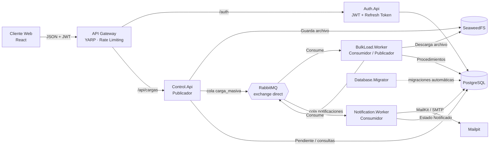

# Reto Técnico – Microservicios de Carga Masiva

🎥 **Video de demostración:** [ver en Google Drive](https://drive.google.com/file/d/12mzIUmMIjVNcM6Fl-A-r8ImMkHiI9W6V/view?usp=sharing)

Sistema distribuido para la **carga masiva de productos desde archivos Excel (.xlsx)**. El archivo se sube desde un cliente React, se guarda en **SeaweedFS**, se procesa de forma asíncrona mediante colas de **RabbitMQ**, se persiste en **PostgreSQL** y al terminar se notifica al usuario por correo con **MailKit**.

Todo está construido en **.NET 10** y se levanta con un solo `docker compose up`.

---

## Contenido

1. [Arquitectura](#1-arquitectura)
2. [Cumplimiento de requerimientos](#2-cumplimiento-de-requerimientos)
3. [Reglas de negocio y estados](#3-reglas-de-negocio-y-estados)
4. [Cómo levantar la solución](#4-cómo-levantar-la-solución)
5. [Cómo probar](#5-cómo-probar)
6. [Base de datos](#6-base-de-datos)
7. [Mensajería](#7-mensajería)
8. [Seguridad](#8-seguridad)
9. [Resiliencia](#9-resiliencia)
10. [Decisiones de diseño](#10-decisiones-de-diseño)
11. [Pruebas unitarias](#11-pruebas-unitarias)
12. [Mejoras pendientes](#12-mejoras-pendientes)

---

## 1. Arquitectura



### Flujo completo

1. **Login**: el cliente envía las credenciales a `/auth/login`. Auth.Api las valida contra la base de datos y devuelve un **JWT** (15 min) en el body y un **refresh token** (7 días) en una **cookie HttpOnly**. Al recargar la página, el cliente recupera la sesión llamando a `/auth/refresh`.
2. **Subida**: el cliente envía el Excel al Gateway con el JWT. El Gateway valida el token y reenvía a **Control.Api**.
3. **Control.Api** valida el permiso del usuario, la extensión, el tamaño y el contenido del archivo. Registra la carga en estado **Pendiente** (auditoría de quién y cuándo), sube el archivo a **SeaweedFS** y publica en la cola `carga_masiva`:
   ```json
   { "idCarga": 123, "rutaArchivo": "seaweed://uploads/2026/11/3f9c...xlsx", "usuario": "user@example.com" }
   ```
   Responde `202 Accepted` de inmediato: el procesamiento es asíncrono.
4. **BulkLoad.Worker** consume el mensaje, pasa la carga a **En proceso**, descarga el Excel, limpia y valida las filas, aplica las validaciones de **duplicidad por periodo** y **de registros**, inserta los datos (**Cargado**), guarda los fallidos en la tabla de auditoría, cierra la carga (**Finalizado**) y publica en la cola `notificaciones`:
   ```json
   { "idCarga": 123, "usuario": "user@example.com", "fechaFin": "2026-11-08T10:20:00Z" }
   ```
5. **Notification.Worker** consume la notificación, envía el correo con **MailKit** y actualiza el estado final a **Notificado**.
6. El cliente muestra el historial y el estado en tiempo real mediante **polling** (cada 3 segundos mientras haya cargas en curso).

### Componentes

| Componente | Tecnología | Responsabilidad |
|---|---|---|
| `client` | React 18 + TypeScript + Vite, nginx | Login, subida de Excel, historial, detalle de estado, contenido cargado y fallidos. |
| `Gateway.Api` | ASP.NET Core + YARP | Punto único de entrada: valida JWT, enruta, rate limiting, CORS y headers de seguridad. |
| `Auth.Api` | ASP.NET Core | `/auth/login`, `/auth/refresh` (rotación de refresh token en cookie HttpOnly), `/auth/logout`, bloqueo por intentos fallidos. |
| `Control.Api` | ASP.NET Core | Valida permiso y archivo, registra la carga (Pendiente), sube a SeaweedFS, publica en `carga_masiva`, expone las consultas. |
| `BulkLoad.Worker` | Worker Service | Consume `carga_masiva`, procesa el Excel, aplica las reglas de negocio y publica en `notificaciones`. |
| `Notification.Worker` | Worker Service | Consume `notificaciones`, envía el correo con MailKit y marca la carga como Notificado. |
| `Database.Migrator` | Consola .NET | Migraciones automáticas: crea usuarios de BD, aplica scripts versionados y crea los usuarios de prueba. |
| `Shared.Messaging` | Class Library | Contratos de los mensajes y la infraestructura común de RabbitMQ (conexión, publicador, consumidor). |

Cada microservicio tiene su propio **Dockerfile** y está organizado en capas: `Domain`, `Application` (casos de uso, interfaces, validaciones), `Infrastructure` (Dapper, SeaweedFS, MailKit, Excel) y `Controllers`/handlers. Las dependencias se resuelven por **inversión de dependencias** (interfaces + DI).

---

## 2. Cumplimiento de requerimientos

| Requerimiento | Implementación |
|---|---|
| .NET | .NET 10 (LTS) en todos los microservicios |
| Arquitectura limpia / Inversión de dependencias / SOLID | Capas por servicio, interfaces en `Application`, implementaciones en `Infrastructure`, un caso de uso por clase |
| JWT + Refresh token | Auth.Api emite JWT HS256 con claims `sub`, `email`, `name`, `role`. Refresh token en cookie HttpOnly, con rotación y detección de reutilización |
| Manejo de excepciones global | `IExceptionHandler` en las APIs (ProblemDetails sin stack trace) y dead letter queue en los workers |
| Logging estructurado | `ILogger` con plantillas y scopes (`IdCarga`, `MessageId`, `CorrelationId`), salida JSON en consola |
| Dockerfile por microservicio + docker-compose | Sí, incluye RabbitMQ, SeaweedFS, PostgreSQL, Mailpit, gateway y cliente |
| Patrón Rate Limiting | Gateway: 10 req/min por IP en `/auth` y 120 req/min general (configurable) |
| Dapper o Entity Framework | **Dapper** sobre Npgsql |
| Circuit Breaker | Polly: HttpClient de SeaweedFS (`AddStandardResilienceHandler`) y envío SMTP |
| Reintentos | Polly: procesamiento de la carga (3 reintentos con backoff exponencial), SeaweedFS y SMTP |
| Migraciones automáticas | Servicio `db-migrator` que aplica scripts versionados al levantar |
| Procedimientos almacenados | Toda la lógica de datos está en funciones/procedimientos de PostgreSQL; los servicios no tienen acceso directo a las tablas |
| Colas `carga_masiva` y `notificaciones`, exchange direct | Exchange `carga_masiva.exchange` (direct) + colas de error (dead letter) |
| SeaweedFS | API HTTP del Filer para subir y descargar archivos |
| MailKit configurable por variables de entorno | `Smtp__Host`, `Smtp__Port`, `Smtp__UseStartTls`, `Smtp__FromAddress`, etc. |
| Tamaño máximo configurable | `UPLOAD_MAX_FILE_SIZE_MB` (por defecto 10 MB) |
| Permiso para ejecutar cargas | Política `PuedeCargar`: roles Administrador y Operador. El rol Consulta no puede subir archivos |
| Frontend: Login, Subida, Historial, Detalle | Las 4 pantallas, más contenido cargado, fallidos y descarga del Excel original |
| Postman | `postman/CargaMasiva.postman_collection.json` |

---

## 3. Reglas de negocio y estados

### Estados de una carga

```
Pendiente ──> En proceso ──> Cargado ──> Finalizado ──> Notificado
 (Control)    (BulkLoad)     (BulkLoad)   (BulkLoad)     (Notification)
```

Cada cambio de estado queda registrado en `carga.carga_archivo_historial` con fecha, detalle y servicio que lo hizo (**trazabilidad**). El campo **resultado** indica cómo terminó la carga:

| Resultado | Significado |
|---|---|
| `Exitoso` | Todas las filas se insertaron. |
| `ConObservaciones` | Se insertaron las filas válidas; el resto quedó en la tabla de fallidos. |
| `Rechazado` | Falló una validación de la carga completa (periodo duplicado o en curso, archivo inválido, sin filas válidas). |
| `Error` | Falla técnica después de los reintentos. |

### Validación de duplicidad por periodo

El Excel tiene la columna `Periodo` y puede traer varios periodos (el archivo del reto trae 2025-01, 2025-02 y 2025-03). Se revisan todos:

- Si algún periodo ya tiene una carga **Cargado, Finalizado o Notificado** → la carga se **rechaza**.
- Si algún periodo tiene otra carga **Pendiente o En proceso** → la carga se **bloquea** (evita cargas simultáneas del mismo periodo).
- Si no hay conflicto, los periodos quedan reservados para la carga y el proceso continúa.

En los dos primeros casos el proceso se finaliza y todas las filas se guardan en la tabla de auditoría con el motivo `PeriodoRechazado`. La validación se hace en `carga.fn_validar_periodos` con *advisory locks*, así dos cargas del mismo periodo no pueden pasar al mismo tiempo.

### Validación de duplicidad de registros

- Si el `CodigoProducto` ya existe en la base de datos, la fila **no se registra** y se reporta como **Existente**.
- Si el código se repite dentro del mismo archivo, se registra la primera aparición y las siguientes se reportan como **Existente**.

### Limpieza de datos

| Columna | Limpieza | Valor por defecto si está vacía |
|---|---|---|
| `Periodo` | Se normaliza a `YYYY-MM` (acepta `2025-03`, `2025/03`, `202503` o una fecha de Excel) | Periodo de la fecha de carga |
| `CodigoProducto` | Se quitan espacios y se pasa a mayúsculas | Es la clave del registro: si está vacío la fila se reporta como `DatoInvalido` |
| `NombreProducto` | Se quitan espacios repetidos | `SIN NOMBRE` |
| `Precio` | Acepta coma decimal (`12,50`) y se redondea a 2 decimales | `0` |

Las **filas vacías no se registran** (ni se cuentan). Las filas con datos inválidos (precio negativo o no numérico, periodo inválido, nombre que empieza con `=`, `+`, `-` o `@`) se guardan como `DatoInvalido` con el detalle del error.

---

## 4. Cómo levantar la solución

### Requisitos

- Docker Desktop (con Docker Compose v2)
- Puertos libres: `3000`, `5000`, `5433`, `8025`, `8888`, `15672`

### Pasos

```bash
# 1. Crear el archivo de variables de entorno
cp .env.example .env          # Windows (cmd): copy .env.example .env

# 2. Construir y levantar todo
docker compose up -d --build

# 3. Revisar el estado (db-migrator debe terminar con "exited (0)")
docker compose ps -a
```

La primera vez demora unos minutos porque descarga las imágenes y compila los proyectos.

### URLs

| Componente | URL | Acceso |
|---|---|---|
| Cliente web | http://localhost:3000 | Usuarios de prueba (abajo) |
| API Gateway | http://localhost:5000 | JWT |
| RabbitMQ | http://localhost:15672 | `RABBITMQ_USER` / `RABBITMQ_PASSWORD` del `.env` |
| Mailpit (correos) | http://localhost:8025 | – |
| SeaweedFS Filer | http://localhost:8888/uploads/ | – |
| PostgreSQL | `localhost:5433` | `POSTGRES_USER` / `POSTGRES_PASSWORD` del `.env` |

### Usuarios de prueba

Los crea el migrador con las contraseñas definidas en el `.env`:

| Usuario | Contraseña (`.env.example`) | Rol | Permisos |
|---|---|---|---|
| `admin@cargamasiva.local` | `Admin#2026` | Administrador | Sube archivos y ve todas las cargas |
| `operador@cargamasiva.local` | `Operador#2026` | Operador | Sube archivos y ve sus propias cargas |
| `consulta@cargamasiva.local` | `Consulta#2026` | Consulta | Solo consulta, no puede subir archivos |

### Comandos útiles

```bash
docker compose logs -f bulkload-worker     # logs de un servicio
docker compose up -d --scale bulkload-worker=3   # escalar el procesamiento
docker compose down                        # detener
docker compose down -v                     # detener y borrar datos (BD, colas, archivos)
```

---

## 5. Cómo probar

Los archivos están en la carpeta `samples/`:

| Archivo | Qué demuestra |
|---|---|
| `carga_masiva_productos.xlsx` | Archivo del reto: 200 filas, 3 periodos. Se insertan **116** productos y **84** filas se reportan como **Existente** (códigos repetidos). Resultado: Con observaciones. |
| `carga_masiva_productos.xlsx` (por segunda vez) | **Rechazado**: los periodos 2025-01 a 2025-03 ya fueron cargados. |
| `productos_periodo_2025-04.xlsx` | Periodo nuevo: 60 productos nuevos y 3 códigos que ya existen (**Existente**). |
| `productos_con_errores.xlsx` | Limpieza y validaciones: valores por defecto, coma decimal, fila vacía ignorada, precio negativo, fórmula, periodo inválido, código vacío. |
| `no_es_excel.xlsx` | Archivo de texto renombrado: Control.Api lo rechaza con `400`. |

Recorrido sugerido:

1. Entrar a http://localhost:3000 con `admin@cargamasiva.local`.
2. Subir `carga_masiva_productos.xlsx` y ver cómo cambia el estado: Pendiente → En proceso → Cargado → Finalizado → Notificado.
3. Abrir **Ver detalle**: trazabilidad, contenido cargado y registros no cargados.
4. Subir el mismo archivo otra vez: queda **Rechazado** por periodo.
5. Revisar el correo en http://localhost:8025 y las colas en http://localhost:15672.
6. Entrar con `consulta@cargamasiva.local`: puede ver las cargas pero no subir archivos.

También se puede probar todo desde Postman importando `postman/CargaMasiva.postman_collection.json` (el login guarda el token automáticamente).

### Endpoints (a través del Gateway)

| Método | Ruta | Descripción |
|---|---|---|
| POST | `/auth/login` | Login. Devuelve el JWT y deja el refresh token en una cookie HttpOnly |
| POST | `/auth/refresh` | Nuevo JWT usando la cookie del refresh token (rotación) |
| POST | `/auth/logout` | Revoca el refresh token y borra la cookie |
| POST | `/api/cargas` | Sube el Excel (`multipart/form-data`, campo `archivo`). Requiere rol Administrador u Operador |
| GET | `/api/cargas` | Historial de cargas |
| GET | `/api/cargas/{id}` | Detalle y trazabilidad de la carga |
| GET | `/api/cargas/{id}/registros?pagina=1&tamano=50` | Contenido del Excel registrado |
| GET | `/api/cargas/{id}/fallidos?pagina=1&tamano=50` | Registros no cargados y su motivo |
| GET | `/api/cargas/{id}/archivo` | Descarga del Excel original desde SeaweedFS |

---

## 6. Base de datos

### Migraciones automáticas

El servicio `db-migrator` se ejecuta al levantar el `docker compose` y los microservicios esperan a que termine bien (`service_completed_successfully`):

1. Crea o actualiza el usuario de base de datos de cada microservicio.
2. Aplica los scripts versionados pendientes de `src/Services/Database.Migrator/Scripts` (estilo Flyway). Cada script corre una sola vez, en una transacción, y queda registrado en `public.historial_migraciones`.
3. Crea los usuarios de prueba si no existen (contraseñas con BCrypt).

| Script | Contenido |
|---|---|
| `V001__esquemas_y_tablas.sql` | Esquemas `seguridad` y `carga`, tablas, índices y restricciones |
| `V002__procedimientos_seguridad.sql` | Login, bloqueo, refresh tokens |
| `V003__procedimientos_carga.sql` | Flujo de estados, validación de periodos, inserción, fallidos y consultas |
| `V004__permisos.sql` | Permisos de cada microservicio |
| `V005__refresh_token_ventana_de_gracia.sql` | Ajuste a la rotación del refresh token (ejemplo de una migración posterior) |
| `V006__reenvio_de_notificacion.sql` | Reenvío de la notificación si la carga quedó Finalizado sin notificar |

### Tablas

| Tabla | Descripción |
|---|---|
| `carga.carga_archivo` | **CargaArchivo**: trazabilidad de cada archivo (usuario, fechas, estado, resultado, contadores) |
| `carga.carga_archivo_historial` | Auditoría de cada cambio de estado |
| `carga.carga_archivo_periodo` | Periodos de cada carga (validación de duplicidad por periodo) |
| `carga.detalle_carga` | **DetalleCarga**: registros fallidos con su motivo y los datos originales (`jsonb`) |
| `carga.data_procesada` | **DataProcesada**: registros extraídos del Excel (`CodigoProducto` único) |
| `seguridad.usuario` | Usuarios, rol, intentos fallidos y bloqueo |
| `seguridad.refresh_token` | Hash de los refresh tokens, expiración y revocación |

### Procedimientos almacenados

| Servicio | Funciones / procedimientos |
|---|---|
| Auth.Api | `fn_obtener_usuario_por_email`, `fn_obtener_usuario_por_id`, `sp_registrar_login_fallido`, `sp_registrar_login_exitoso`, `sp_guardar_refresh_token`, `fn_rotar_refresh_token`, `sp_revocar_refresh_token` |
| Control.Api | `fn_registrar_carga`, `fn_listar_cargas`, `fn_obtener_carga`, `fn_listar_historial`, `fn_listar_registros`, `fn_listar_fallidos`, `sp_finalizar_carga` |
| BulkLoad.Worker | `fn_iniciar_proceso`, `fn_validar_periodos`, `fn_insertar_registros`, `sp_registrar_fallidos`, `sp_marcar_cargado`, `sp_finalizar_carga` |
| Notification.Worker | `fn_obtener_carga`, `sp_marcar_notificado` |

La **máquina de estados** vive en los procedimientos: por ejemplo, `sp_marcar_cargado` solo funciona si la carga está En proceso y `sp_marcar_notificado` solo si está Finalizado.

Los registros se envían a la base de datos como JSON en una sola llamada (`jsonb_to_recordset`), así una carga de miles de filas no hace miles de `INSERT`.

---

## 7. Mensajería

| Elemento | Nombre | Detalle |
|---|---|---|
| Exchange | `carga_masiva.exchange` | Tipo **direct** |
| Cola 1 | `carga_masiva` | Routing key `carga.registrada`. Publica Control.Api, consume BulkLoad.Worker |
| Cola 2 | `notificaciones` | Routing key `carga.finalizada`. Publica BulkLoad.Worker, consume Notification.Worker |
| Dead letter | `carga_masiva.dlx` → `carga_masiva.error`, `notificaciones.error` | Mensajes que fallaron después de los reintentos |

- Mensajes **persistentes** y publicados con **publisher confirms** (RabbitMQ confirma que los guardó).
- **Ack manual**: el mensaje solo sale de la cola cuando se procesó bien.
- **Prefetch 1** por consumidor; para procesar más rápido se escalan réplicas del worker.
- **Idempotencia**: si RabbitMQ entrega dos veces el mismo mensaje, `fn_iniciar_proceso` lo detecta y no se procesa ni se notifica dos veces. Si un worker se cae a mitad de una carga, al reprocesarla se limpia lo que quedó a medias. Si la carga quedó Finalizado pero falló la publicación de la notificación, el reintento solo vuelve a publicarla (Notification ignora duplicados).
- Cada mensaje lleva `MessageId` y `CorrelationId` (= idCarga) para seguirlo en los logs de todos los servicios.

---

## 8. Seguridad

Se tomó como referencia el **OWASP Top 10**:

| Riesgo | Medidas |
|---|---|
| **A01 Control de acceso** | JWT obligatorio en `/api/cargas` (validado en el Gateway y otra vez en Control.Api). Política por rol para subir archivos. Un Operador solo ve sus cargas: si pide una ajena recibe 404 (evita IDOR). Solo el Gateway y el cliente publican puertos. |
| **A02 Criptografía** | Contraseñas con BCrypt (factor 12). JWT HS256 con clave de 256 bits como mínimo, validada al iniciar; se restringe el algoritmo aceptado. Refresh tokens aleatorios de 512 bits y en la BD solo se guarda su hash SHA-256. Secretos en variables de entorno (`.env` está en `.gitignore`). |
| **A03 Inyección** | Consultas parametrizadas con Dapper y procedimientos almacenados (sin SQL concatenado). Bloqueo de inyección de fórmulas de Excel. `HtmlEncode` en el correo. React escapa el contenido. Expresiones regulares con timeout (ReDoS). |
| **A04 Diseño inseguro** | Rate limiting en el Gateway. Bloqueo de la cuenta 15 minutos tras 5 intentos fallidos. Límites de tamaño en Gateway, Kestrel y multipart. Límite de filas por archivo. |
| **A05 Configuración** | Headers de seguridad (CSP, `X-Content-Type-Options`, `X-Frame-Options`, `Referrer-Policy`) en el Gateway y en nginx. CORS solo para el origen del cliente. Errores genéricos sin stack trace. Contenedores con usuario sin privilegios y `no-new-privileges`. Puertos de infraestructura solo en `127.0.0.1`. |
| **A06 Componentes** | Versiones fijadas de paquetes NuGet, npm (`package-lock.json`) e imágenes (salvo Mailpit, solo de desarrollo). `npm audit` sin vulnerabilidades. |
| **A07 Autenticación** | Mismo mensaje para usuario inexistente, clave incorrecta o cuenta bloqueada; verificación BCrypt contra un hash ficticio cuando el usuario no existe (evita enumeración por tiempo). Rotación de refresh token: si se reutiliza uno revocado se revocan todos los del usuario (con 30 s de gracia para pestañas simultáneas). El JWT vive solo en memoria y el refresh token en una cookie `HttpOnly`, `SameSite=Strict` y `Path=/auth` (JavaScript no puede leerla). |
| **A08 Integridad** | Máquina de estados en la BD. Mensajes idempotentes. |
| **A09 Logging** | Logs estructurados de logins fallidos, bloqueos, cargas y errores, sin contraseñas ni tokens. |
| **A10 SSRF** | Las rutas de SeaweedFS las genera el servidor y solo se aceptan rutas dentro de `uploads/`. |

**Subida de archivos (OWASP File Upload):** solo `.xlsx`, tamaño máximo configurable, se verifica que el contenido sea realmente un Excel (firma ZIP y `xl/workbook.xml`), no se confía en el `Content-Type` del navegador y el archivo se guarda con un nombre generado por el servidor.

**Base de datos con mínimo privilegio:** cada microservicio usa su propio usuario de PostgreSQL, **sin permisos sobre las tablas**: solo puede ejecutar los procedimientos que necesita (`SECURITY DEFINER`). Por ejemplo, Notification.Worker solo puede leer una carga y marcarla como notificada.

---

## 9. Resiliencia

| Patrón | Dónde | Configuración |
|---|---|---|
| Rate Limiting | Gateway | Ventana fija por IP: 10/min en `/auth`, 120/min general. Responde `429` con `Retry-After` |
| Reintentos | Procesamiento de la carga | 3 reintentos con backoff exponencial y jitter (2s, 4s, 8s) |
| Reintentos + Circuit Breaker + Timeout | HttpClient de SeaweedFS (Control y BulkLoad) | `AddStandardResilienceHandler` de .NET (Polly) |
| Reintentos + Circuit Breaker | Envío de correo (MailKit) | 3 reintentos; el circuito se abre 30 s si falla el 50 % de los envíos |
| Dead Letter Queue | RabbitMQ | Los mensajes que fallan después de los reintentos van a `*.error` |
| Reconexión automática | RabbitMQ | `AutomaticRecoveryEnabled` + reintento al iniciar el consumidor |

---

## 10. Decisiones de diseño

- **Procesamiento asíncrono**: Control.Api responde `202` apenas encola el archivo. Un archivo grande no bloquea la petición y el procesamiento se escala con más réplicas del worker.
- **RabbitMQ.Client directo** (sin librerías intermedias): permite declarar exactamente las colas `carga_masiva` y `notificaciones`, el exchange direct y el formato JSON de los mensajes que pide el reto.
- **Dapper + procedimientos almacenados**: la lógica de datos queda en la base de datos (validación de periodos con bloqueos, inserción masiva con JSON, máquina de estados) y los servicios solo ejecutan procedimientos.
- **Migrador propio con scripts SQL versionados**: el esquema queda explícito y revisable (tablas, índices, procedimientos y permisos), se aplica solo al levantar y los servicios no necesitan permisos para modificar la estructura.
- **Una base de datos con esquemas y usuarios separados**: respeta el diagrama del reto sin perder aislamiento entre servicios.
- **ExcelDataReader**: lee el Excel fila por fila sin cargar el libro completo en objetos.
- **Filas inválidas no detienen la carga**: se insertan las válidas y las demás quedan auditadas con su motivo; la validación de periodo sí rechaza la carga completa, como pide el reto.

---

## 11. Pruebas unitarias

Requieren el SDK de .NET 10:

```bash
dotnet test CargaMasiva.sln
```

Cubren: lectura del Excel del reto (200 filas), limpieza y validación de filas, valores por defecto, duplicados, rechazo por periodo, idempotencia, validación del archivo subido, saneamiento del nombre, permisos por rol, login, bloqueo y refresh token.

---

## 12. Mejoras pendientes

- Patrón **Outbox** en Control.Api: guardar la carga y su mensaje en la misma transacción (tabla de salida) y publicarlo con un proceso en segundo plano. Hoy, si RabbitMQ rechaza el mensaje la carga se marca Error y se responde 503; solo queda sin cubrir una caída del proceso justo entre el registro y la publicación.
- Proceso de conciliación que detecte cargas que lleven demasiado tiempo en Pendiente y archivos de SeaweedFS sin carga asociada.
- HTTPS/TLS en el Gateway (o en un ingress) y HSTS.
- Cookie del refresh token con `Secure=true` (requiere HTTPS; en local va en `false`).
- Notificaciones en tiempo real con SignalR en lugar de polling: con muchos usuarios, el servidor avisa los cambios de estado en vez de recibir una consulta cada 3 segundos por pantalla abierta.
- Caché (HybridCache o Redis) para las consultas de cargas **finalizadas**: su detalle, registros y fallidos ya no cambian, así que se pueden cachear sin riesgo. Los estados de las cargas en curso no se cachean porque cambian cada segundo.
- Pruebas de integración con Testcontainers.
- Observabilidad: centralizar los logs (ya salen en JSON con `IdCarga` y `CorrelationId`) en ELK (Elasticsearch + Kibana), Seq o Grafana Loki, sin cambiar código; trazas distribuidas con OpenTelemetry; alertas ante muchos logins fallidos; y health checks de Docker para los servicios .NET.
- SeaweedFS con master, volume y filer separados y replicación.

---

## Solución de problemas

| Problema | Solución |
|---|---|
| Un puerto ya está en uso | Cambiar el puerto de la izquierda en `docker-compose.yml` (por ejemplo `127.0.0.1:5434:5432`). |
| `db-migrator` termina con error | `docker compose logs db-migrator`. Las contraseñas de BD deben tener solo letras y números (mínimo 12). |
| Error de autenticación de BD después de cambiar el `.env` | `docker compose up -d --build` vuelve a ejecutar el migrador y actualiza las contraseñas. |
| El cliente muestra "No se pudo conectar con el servidor" | Verificar que `gateway` esté arriba con `docker compose ps`. |
| No llega el correo | Revisar `docker compose logs notification-worker` y la cola `notificaciones.error` en RabbitMQ. |
